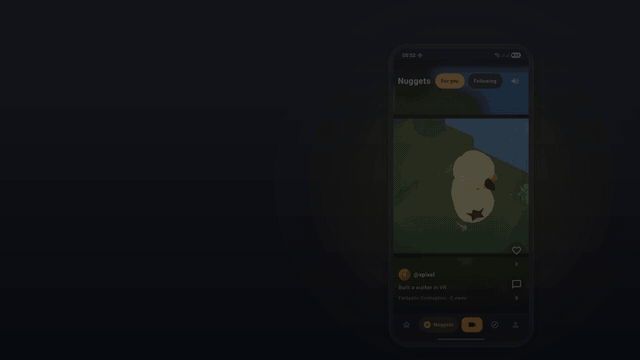

# MinedIt (Android)

**Record it. Mine it. Post it.**

[](docs/minedit-launch.mp4)

▶ **[Watch the full 40-second launch video](docs/minedit-launch.mp4)**

MinedIt is an Android gaming-clip app (think Medal.tv) with an AI brain. It records your gameplay in the background, lets you search *inside* your clips for what happened, cuts the best moments into captioned 9:16 videos, scores how viral a clip looks and flags 18+ content before you post.

This repo is the Android app. The backend (FastAPI on Cloud Run) lives in [virajchogle/minedtv](https://github.com/virajchogle/minedtv), and the web app is at [minedtv.vercel.app](https://minedtv.vercel.app).

> Hackathon project: built for speed, not production hardening.

## Features

| Feature | What it does |
|---|---|
| **Mine it (recorder)** | Records the screen continuously into rolling segments; tap **Mine it** (in the app, the notification or a floating button) to save the last 15 s–2 min. Captures game audio (Android 10+ playback capture) and the mic. |
| **Home & Explore** | Feed of regular (landscape) clips: For You, Following, Trending, New; game tiles and trending clips. |
| **Nuggets** | A full-screen vertical swipe feed of short 9:16 clips, ranked by likes, comments, views and virality. Double-tap to like, tap to pause. |
| **Semantic search** | Search clips by what happens in them ("zombie police station"), not just titles. |
| **Search inside your clips** | Find moments in your own library ("awp knife kill") and jump straight to the second they happen. |
| **Enhance with AI** | Share to TikTok, Instagram Reels or MinedIt Nuggets. The server cuts the **best moment** or a **montage**, reframes to 9:16 and burns in captions with a hook; the app adds a MinedIt end card. Shows *why* each edit was made. |
| **Creator dashboard** | Published vs drafts, daily views, likes and comments (7/30/90 days vs the previous period), and per-clip virality: score, moment-by-moment curve and what drives it. |
| **Content check** | Uploads are moderated from speech and on-screen frames. Shows whether a clip is clean, tagged 18+ or blocked, with timestamped flags you can tap to play. 18+ clips get a badge and a publish confirmation. |
| **Social** | Comments and replies, follows, likes and an Inbox with notifications. |

## Tech stack

- Kotlin, Jetpack Compose (Material 3), single-activity app
- Media3: ExoPlayer + HLS for playback, Transformer for on-device edits (trim, crop, captions, end card)
- Recorder: MediaProjection → VirtualDisplay → MediaCodec (H.264 + AAC) → rolling MP4 segments, joined with MediaMuxer; an AccessibilityService draws the floating button
- Coil 3 for images
- minSdk 28, targetSdk 36, AGP 9, Kotlin 2.0

## Getting started

1. Clone and open in Android Studio.
2. Add the backend settings to `local.properties` (it's git-ignored, so **never commit your key**):
   ```properties
   minedtv.apiKey=<ask the backend team>
   minedtv.userId=<a demo user id, e.g. ShadowSniper's>
   ```
   Without them the app runs on built-in sample data.
3. Run on a device: `./gradlew installDebug`.

Recording needs screen-capture consent and the microphone permission; the floating button needs **Settings → Accessibility → MinedIt Clip button**.

## Project structure

```
app/src/main/java/com/example/minedtv/
├── MainActivity.kt            Navigation: Home · Nuggets · Mine it · Explore · Profile
├── data/
│   ├── api/MinedTvApi.kt      Backend client (feeds, clips, search, uploads, highlights, analytics…)
│   ├── share/                 Share flow: AI edit (server highlights + on-device AiVideoEditor), end card, share intents
│   ├── search/                Semantic search (remote + sample)
│   ├── dashboard/             Creator dashboard data (live analytics + demo data)
│   └── moderation/            Content check model
├── recorder/                  Screen recorder, segment writer, clip joiner, floating button service
└── ui/
    ├── screens/               Home, Nuggets (ReelsScreen), Clipper, Explore, Profile, Inbox, Clip detail, Splash
    ├── share/                 Share / Enhance with AI flow
    ├── search/                Moment search
    ├── dashboard/             Creator dashboard + charts
    ├── moderation/            Content check screen
    └── components/, theme/    Shared UI and the dark + gold theme
```

## Backend endpoints used

All requests send `X-API-Key`, the acting user as `X-User-Id` and a per-install `X-Viewer-Id`. Full contract: `backend/docs/android-integration.md` in the backend repo.

- Feeds: `GET /feed?format=long|short&sort=top`, `/feed/following`, `/users/{id}/clips`
- Clips: `/clips/{id}`, publish/unpublish, like, view, comments, `export`
- AI edits: `POST/GET /clips/{id}/highlights` (`mode=single|montage`), `/clips/{id}/creator-pack`, `/creator/analyze`
- Search: `GET /search` (global and your library)
- Uploads: `POST /uploads` (with `as_reel` / `reel_of` for Nuggets) → PUT to storage → `/uploads/{id}/complete`
- Insights: `GET /clips/{id}/virality`, `GET /users/{id}/analytics`, `GET /sessions/{id}` (moderation)
- Social: follows, `/notifications`

## Known limitations

- Game audio is silent for games that opt out of Android playback capture.
- Captions from server highlights can sit low in the frame and aren't always aligned to the chosen moments (open backend issue).
- No push notifications and no messaging; the Messages tab is sample data.
- The app acts as one demo user set in `local.properties` (no login screen yet).

## Credits

Demo Nuggets include gameplay from Wikimedia Commons under CC BY / CC BY-SA licences; see the attribution list shipped with the demo assets. Logo: a brain, because **Mined** ≈ **Mind**.

Launch video music is original (generated for the video). The footage is the app itself.
